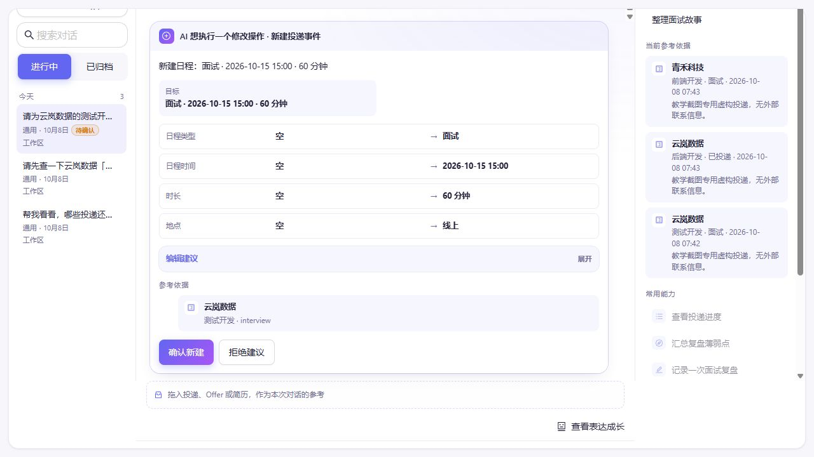
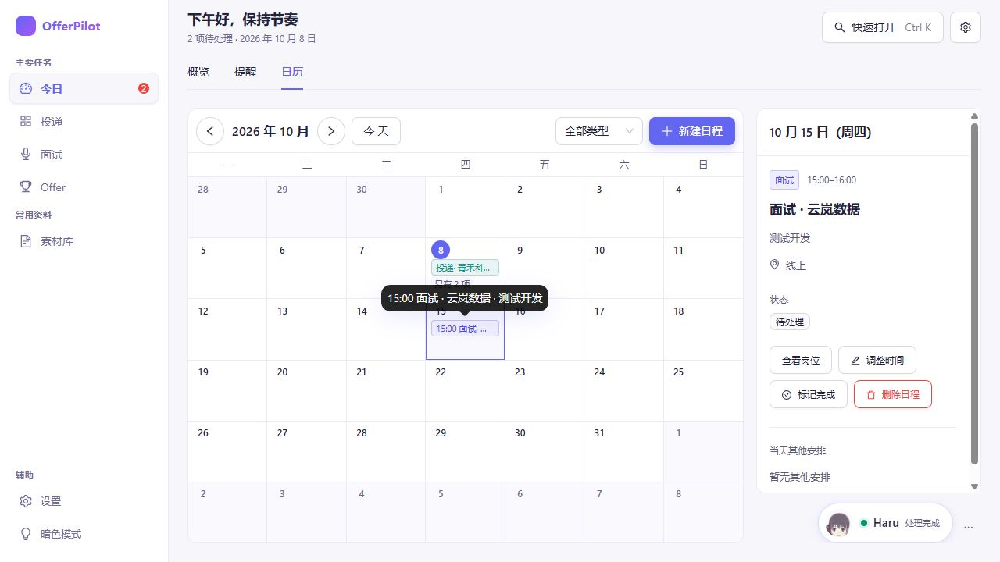
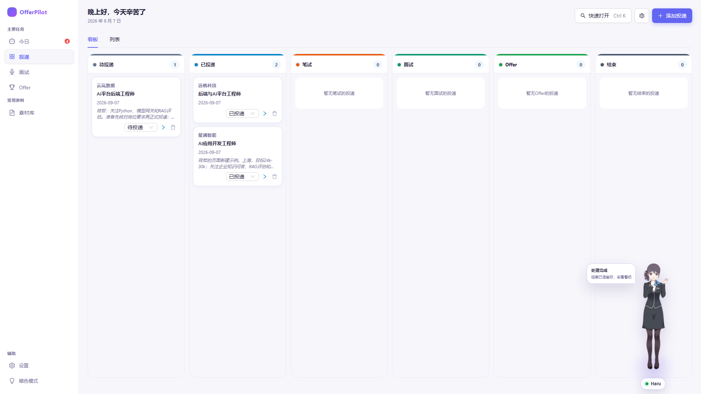
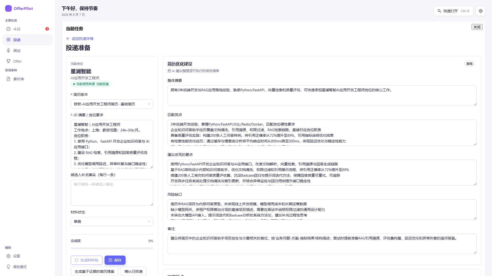
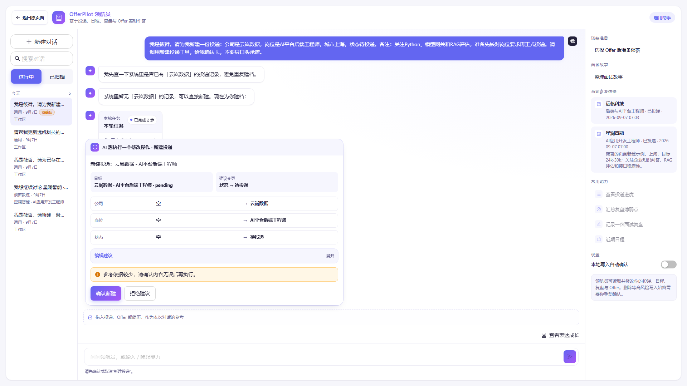
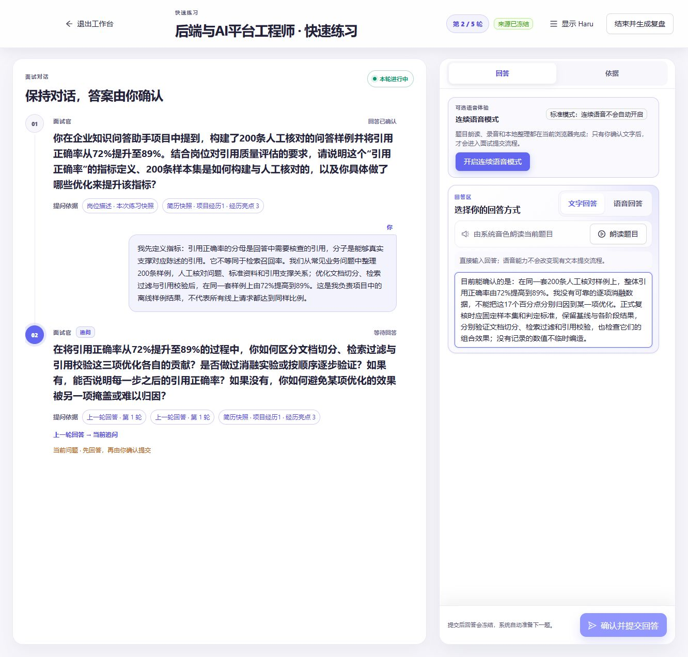
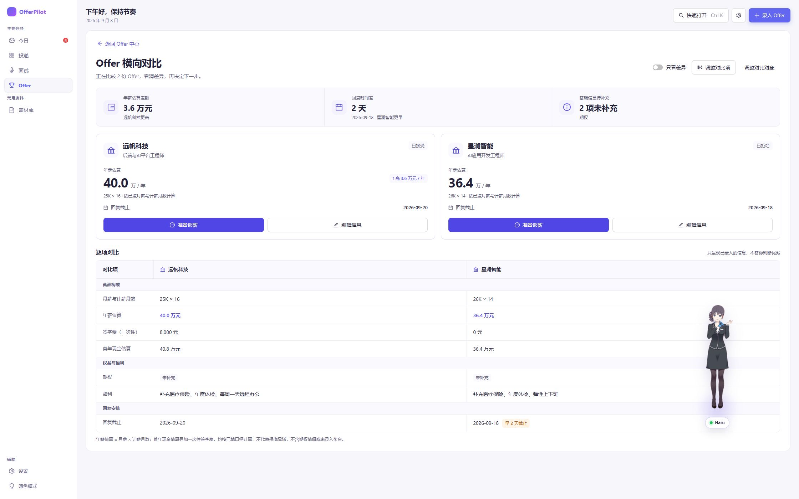

# OfferPilot — 开源、本地优先的求职 Agent

[简体中文](README.md) | [English](README.en.md)

**帮你准备下一场面试，也让你看懂 Agent 怎样把事情做成。**

OfferPilot 由 offercontext 维护，把投递、简历、面试与 Offer 放进同一个工作台。
内置 Pilot 结合你保存的求职资料查询信息、起草内容、调用工具，并在你确认后更新关键求职记录。
它不会自动投递，也不会替你联系招聘方。

想研究 Agent 的 AI builder，也可以从同一个求职场景出发，沿着图解、小实验与源码，
理解工具调用、上下文、写入确认和执行控制。

[Windows 未签名测试版下载](https://github.com/offercontext/offerPilot/releases/tag/v0.1.0-desktop.1)｜[Docker / 源码启动](#快速开始)｜[看懂 Agent](#不仅能用也可以拆开学)｜[用户指南](docs/product-manual/产品说明书.md)

Windows 安装包为实验性预发行版，请先阅读下方[测试版边界](#快速开始)。基础投递记录无需配置 AI；
使用 AI 时需连接自己的模型服务，相关资料可能离开设备并产生服务商费用。

## 先看它怎样记下一场面试

下面复用一次真实操作的素材：2026-10-08，在固定源码基线 `c0a447bb` 上使用隔离的虚构数据与真实模型采集，
不代表当前 Windows 测试版的完整验收。公司、岗位与日期均为演示案例，不是你的待办。

> 请为云岚数据的测试开发岗位新增面试日程：2026 年 10 月 15 日，北京时间下午 3 点（UTC+8），线上，时长 60 分钟。

**查询已有投递 → 提出保存建议 → 你核对并确认 → 程序保存 → 在日历核对结果。**

1. Pilot 借助工具查找对应投递，结合返回资料提出面试安排。
2. 确认卡展示准备保存的内容；此时尚未新增日程。
3. 确认后，程序保存同一场面试，再到日历核对公司、岗位和时间。此次操作没有向招聘方发送通知。





AI 说“记好了”还不够，记录要真正保存，内容也要核对正确。
[查看完整过程](docs/learn/01-record-an-interview.md)与[素材、版本及验证范围](docs/learn/images/runtime-20261008/README.md)。

## 快速开始

Windows 用户可先阅读下方测试版边界；也可以选择 Docker 或源码方式启动，完成其中一种即可：

- Docker 方式需要 Git 和可用的 Docker 环境，不必单独安装 Python 或 Node.js。
- 源码方式需要 Git、uv、Python 和 Node.js/npm。项目声明 Python 最低版本为 3.10；当前 Docker 构建使用 Python 3.12 和 Node.js 20，这些构建版本不等于源码运行的最低要求。

### Windows x64 桌面测试版（未签名）

[下载 v0.1.0-desktop.1 测试版](https://github.com/offercontext/offerPilot/releases/tag/v0.1.0-desktop.1)。
在 Release 的 Assets 中下载 `OfferPilot-Desktop-0.1.0-desktop.1-win-x64-setup.exe`
及同名 `.sha256` 文件；不要把自动生成的 Source code 压缩包当作安装器。

1. 这是 Windows x64 的实验性预发行版，不是稳定生产版本；无需另装 Python、Node.js 或 Docker。
2. 安装前用 PowerShell 执行 `Get-FileHash .\OfferPilot-Desktop-0.1.0-desktop.1-win-x64-setup.exe -Algorithm SHA256`，核对 Release 与 `.sha256` 中的摘要。哈希只能校验文件完整性，不能替代发布者签名。
3. 核对来源和哈希后，双击安装器，按向导选择安装目录，再从桌面快捷方式启动。未签名安装器可能触发 Windows SmartScreen／未知发布者提示；若浏览器、Windows 或安全软件阻止下载或运行，请停止并报告，不关闭防护或绕过警告。
4. 初次使用请先用测试数据。安装新版前完全退出应用并备份 `%APPDATA%\OfferPilot Desktop\`；桌面工作区与源码版的 `~/.offerpilot` 独立，不自动迁移，尚不保证升级／降级兼容。卸载默认保留应用数据，不等于已有可靠备份。

此测试版未启用正式更新渠道，应用内检查／下载／安装更新不可用；后续测试版请回到 Releases 手动获取。
EXE 的真实 QQ 邮箱配置与恢复读取默认禁用；可使用手动粘贴邮件与候选审阅。
AI 功能仍需自行配置模型服务，可能发送相关资料并产生费用。详细构建来源、校验值、验证范围见 Release；工程边界见[桌面验证说明](docs/architecture/desktop-validation.md)和[更新说明](docs/architecture/desktop-updates.md)。

### Docker

```bash
git clone https://github.com/offercontext/offerPilot.git offerpilot
cd offerpilot

docker build -t offerpilot .
docker run --rm -p 127.0.0.1:8080:8080 -v offerpilot-data:/data offerpilot
```

打开 `http://localhost:8080`。

### 从源码启动

```bash
git clone https://github.com/offercontext/offerPilot.git offerpilot
cd offerpilot
uv sync
cd web
npm ci
npm run build
cd ..
uv run oc start
```

打开 `http://localhost:8080`。上述两种方式均以本机访问为默认用途。

### 求职邮件助手（实验功能）

设置中的求职邮箱默认手动同步。邮件先形成待确认建议，在“今日提醒”逐项核对后
才写入事件；不会自动变更投递阶段，也不会发信。取消、复杂时间、Offer 等仅供人工处理。

真实 QQ 安全配置默认关闭。Windows 本机测试目录已验证手动读取、5 分钟自动读取
并生成待审建议；这不是所有平台、异常恢复或真实 AI 的完整验收。当前仅支持直接访问后端设备的
本地回环页面，不支持经反向代理或 Docker／云端远程页面输入授权码。
需要该 Python 环境已有 `keyring` 支持库及可用的 Windows Credential Manager、
macOS Keychain 或 Linux Secret Service；仅安装 Python 包不等于系统安全库可用。
不满足条件时不会降级到明文文件，可以继续手动粘贴邮件。

在受支持主机上，用户可显式使用 `uv run oc start --host 127.0.0.1 --enable-local-mail-setup`
开启本地配置入口，并亲自在页面输入和提交 QQ 邮箱授权码。测试只验证登录和目录；
之后还需另行选择目录并确认保存到系统凭据库，默认不读正文、不启用自动同步。
后续运行同一真实连接也需该显式启动方式，普通启动不会恢复真实邮箱读取。
同一数据目录的真实邮箱能力只允许一个后端持有；原生排他锁不可用或已被占用时会拒绝启用。
不要把授权码交给聊天、环境变量、仓库、截图或普通备份。QQ 授权码可能具备多协议能力，
目录范围和只读行为是本产品约束，并非授权码天然只读。

断开先停止检查，再删除本机凭据；删除失败会保留待清理状态供重试，QQ 侧撤销授权码
仍需用户自行操作。当前建议使用有限的离线规则；外部模型适配仅有注入测试，
生产调用尚未接通，不会继承其他功能的 AI 配置。复杂语义与时间需人工核对。
真实凭据失效等异常路径仍需补验；合成故障测试不能替代各平台真实验证。

### 数据保存在哪里

| 启动方式 | 默认数据位置 |
| --- | --- |
| Windows 桌面测试版 | `%APPDATA%\OfferPilot Desktop\data`（独立工作区） |
| 源码启动 | 用户主目录下的 `~/.offerpilot`，可通过 `OFFERPILOT_DATA` 调整 |
| 上述 Docker 命令 | `offerpilot-data` 数据卷，挂载到容器内的 `/data` |

### 第一次使用

先记录一个岗位，不必先配置 AI。打开投递看板，添加公司和岗位，再进入详情保存岗位描述。

需要 AI 辅助时，再到“设置 → AI 与模型 → 配置 AI”填写模型服务信息，测试连接、应用到 Provider 列表，最后点击页面顶部“保存”。完整步骤见[第一次使用指南](docs/product-manual/产品说明书.md#start)。

## 连接 DSH 和其他外部 Agent

源码版安装 `mcp` extra 后，可通过 stdio MCP 查询明确授权的投递与事件，并提出面试创建/改期请求。
默认只读；面试提案需另行授权，保存仍由用户在独立可信终端核对确认。MCP 不提供模型自调用的确认工具。
DSH 使用通用 MCP 客户端配置，无需 OfferPilot 原生插件。安装、配置、授权范围及本机信任限制见[接入说明](docs/architecture/external-agent-mcp.md)。

## 求职过程中，可以怎样使用它

| 功能 | 具体用途 |
| --- | --- |
| 投递管理 | 按公司、岗位和阶段跟进求职进度，关联岗位描述与面试安排 |
| 简历与材料准备 | 管理简历版本，结合岗位要求生成并审阅材料建议 |
| 面试准备与模拟 | 根据简历和岗位描述练习问答，查看 AI 追问与反馈 |
| 面试复盘 | 保存面试记录，选择并确认需要继续练习的重点 |
| Offer 对比与谈薪 | 比较已填写的薪酬、福利和答复期限，准备谈薪沟通 |
| Pilot 求职 Agent | 结合资料查询、分析和起草内容，调用工具，并在确认后更新关键记录 |

本仓库介绍本地部署版本。在线服务可访问
[offerContext Hub](https://hub.offercontext.cn)；
其功能与数据处理方式以站内说明为准，不默认与本地版本一致或互通。

## 真实界面

以下为本地部署开发版的实际界面，截图更新于 2026 年 9 月。不同版本的功能与界面可能存在差异，截图对应版本见[用户指南](docs/product-manual/产品说明书.md)。

### 1. 跟进每个岗位的投递进度

在同一看板中查看公司、岗位与当前阶段，按待投递、已投递、笔试、面试、Offer 和结束整理进展。



### 2. 为目标岗位准备投递材料

在投递详情中选择简历和本次使用的岗位描述（JD），进入材料工作区生成并审阅建议。确认后创建岗位简历版本，保留基础简历。



### 3. 结合求职资料使用 AI 助手

在同一个会话中查询投递进展、整理岗位资料或起草下一步计划，并对照右侧参考资料核对建议。



### 4. 面试前练习，面试后整理经验

从已安排的面试进入练习，或直接使用“快速模拟”，选择并核对本次岗位资料与简历后开始问答。独立练习不要求先创建真实投递或日程。



### 5. 比较 Offer 条件，准备谈薪

录入 Offer 后可以比较已知薪酬条件、补充自定义比较维度，并进入谈薪准备或谈薪教练，整理下一次沟通的重点。



## Haru 与 Pilot

Pilot 是负责对话与任务协作的内置 Agent；Haru 是桌面宽屏上的可选角色入口。
喜欢角色交互，可以从 Haru 进入；喜欢清爽界面，也可以隐藏它，继续使用 Pilot。
Haru 采用 Live2D 官方样例角色，并非 OfferPilot 原创角色，归属与使用条件见[许可证](#许可证)。

## 不仅能用，也可以拆开学

求职者可以直接使用工作台，不需要先学习 Harness。AI builder 也可以只研究一个具体问题：
**为什么同一条面试安排，重复确认也不该保存两遍？**

- **先看懂**：从[一场面试怎样被记录](docs/learn/01-record-an-interview.md)开始，再按[四篇短路线](docs/learn/README.md)看清资料、模型、工具与人的分工。无需安装项目或写代码。
- **动手试**：运行[只用 Python 标准库的小实验](docs/learn/examples/README.md)，观察“确认前 0 条 → 确认后 1 条 → 重复确认仍为 1 条”。实验使用模拟模型，不需要模型密钥，不是模型能力评测。
- **拆开实现**：按兴趣阅读[Harness 源码导读](docs/learn/advanced/README.md)，追踪 Agent Loop、上下文、写入确认、取消与恢复、运行记录和验证。

学习材料以具体源码基线与验证记录为依据，尚未开展读者试读；它是一条实战阅读与实验路线，不保证读完就能独立实现完整系统。

## 参与项目

发现问题或有改进建议，欢迎[提交 Issue](https://github.com/offercontext/offerPilot/issues)。
想贡献改动，请先阅读[贡献指南](CONTRIBUTING.md)，说明目标、修改范围与实际验证结果。

## 隐私、费用与使用限制

- 本地部署将业务数据保存在你的设备上。使用 AI 功能时，相关资料会发送给你配置的模型服务；本地存储不代表所有 AI 处理都在本地完成。模型调用可能产生服务商费用。
- 模拟面试录音只存在于当前页面，不上传、不持久化；离线 Whisper 模型仅在你主动点击后从 Hugging Face 下载到浏览器缓存。
- Pilot 对关键求职记录的修改默认需要你的确认；请核对系统确认卡后再执行。OfferPilot 不会自动投递，也不会替你向招聘方发送消息。
- AI 输出可能包含错误。采用前请核对经历、数字、日期和承诺；是否投递、接受 Offer 或如何谈薪，仍由你决定。

## 常见问题

### 不配置 AI，也能使用 OfferPilot 吗？

可以。记录投递、保存岗位描述和手动编辑资料等基础功能不要求先配置 AI。
材料生成、模拟问答和 AI 分析等功能需要配置相应的模型服务。

### 本地优先是否意味着资料不会离开设备？

不是。业务数据保存在本地工作区，但使用 AI 功能时，
相关资料会发送给你配置的模型服务，并可能产生服务商费用。
本地保存不等于所有 AI 计算都在本地完成。

### OfferPilot 会自动投递简历或联系招聘方吗？

不会。OfferPilot 用于管理求职过程、准备材料和整理建议，
不自动向招聘方投递或发送消息。关键求职记录的修改默认需要用户确认。

详细操作与问题排查见[用户指南](docs/product-manual/产品说明书.md#s12)。

## 许可证

[AGPLv3](LICENSE)

### 第三方角色与运行时

桌面宽屏的 Pilot 看板娘使用 Live2D 官方样例角色 Haru 受付版与 Cubism Core。相关角色、模型数据及运行时版权归 Live2D Inc. 所有，不包含在 OfferPilot 的 AGPLv3 授权中；使用与分发需同时遵守 [Live2D 样例模型条款](https://www.live2d.com/eula/live2d-sample-model-terms_en.html) 与 [Live2D SDK 许可](https://www.live2d.com/en/sdk/license/)。

> This content uses sample data owned and copyrighted by Live2D Inc. The sample data are utilized in accordance with terms and conditions set by Live2D Inc. This content itself is created at the author’s sole discretion.

### 离线语音模型与运行时

可选离线转写使用 Apache-2.0 许可的 `@huggingface/transformers`、ONNX Runtime Web 与 [`onnx-community/whisper-small`](https://huggingface.co/onnx-community/whisper-small)。模型固定到 revision `461d552a09349d5d0d0779b40dd79800eaa3e35a`，不会提交到 Git 仓库或打入模型权重；用户主动下载后仅缓存在当前浏览器。详细说明见 [`web/public/offline-whisper-NOTICE.md`](web/public/offline-whisper-NOTICE.md)。
